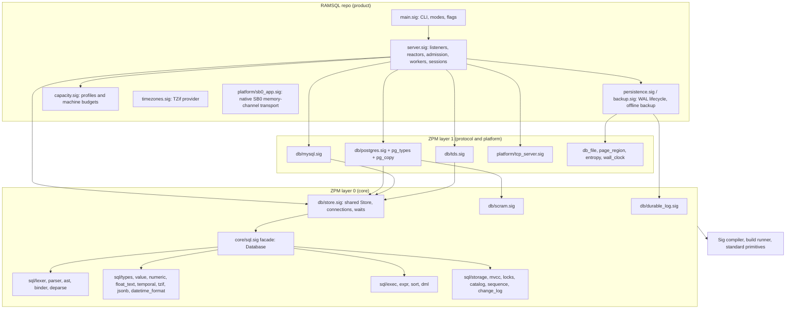

# Architecture overview

RAMSQL is an allocator-free, in-memory SQL server. PostgreSQL is the default
protocol and semantic reference; MySQL and TDS are experimental adapters over
the same engine. This page explains how the pieces fit together. Per-module
detail lives in [`docs/modules/`](../modules/README.md).

Baseline: RAMSQL `origin/main` 6d677ee (PR #35), pinning ZPM `2f060c2`, built
with Sig 0.6.4 (`sig-0.6.4-zig0.17.0.90a898d`).

## 1. Layers

Rules (from `AGENTS.md`): reusable SQL, storage, transactions and wire codecs
live in ZPM. RAMSQL owns listeners, capacity profiles, reactor policy,
persistence lifecycle, integration tests, benchmarks and releases. Lower layers
never import RAMSQL. Everything is fixed-capacity or caller-owned; there is no
heap allocator, SQLite, C library or language runtime dependency.

## 2. Request lifecycle (PostgreSQL, simple query)

1. `tcp_server` accepts a loopback connection on a reactor (one by default,
   up to `--workers` on Windows and no-libc Linux).
2. Admission charges client buffers and stack allowance to the machine byte
   ledger. Failure returns SQLSTATE `53200` (memory) or `53300` (connection limit).
3. The reactor passes received bytes to `postgres.Session.handle(conn, input, output)`.
   It returns `consumed`, `written` and `close`. Zero consumed means an
   incomplete frame. The reactor keeps unconsumed input and drains output with
   partial-write tracking before calling again.
4. Startup, then SCRAM-SHA-256 when a verifier is configured (default for the
   durable server). There is no TLS: `SSLRequest` is refused.
5. The codec calls the shared `Store` connection. `Store` owns one
   `sql.Database`. Each statement takes a fresh READ COMMITTED snapshot.
6. `sql.Database` lexes, parses, binds and executes into caller-owned result
   storage. Specialized executors (streamed joins, dense and typed groups,
   compact scans, synopses) handle eligible shapes; everything else uses the
   general path.
7. A conflicting writer returns `WouldBlock`. The codec reports
   `Reply.blocked`, the reactor parks the connection and re-delivers the same
   statement after `wakeReady()`. Lock timeout, statement timeout, cancel and
   deadlock end the wait with `55P03`, `57014` or `40P01`.
8. Rows are encoded (text or binary) into the output buffer. A PostgreSQL
   session keeps at most one materialized suspended portal.

Eligible autocommit `SELECT`/`WITH` statements on idle connections can run on
worker-owned parser and execution storage concurrently with other reads. A
reader/writer gate keeps publication and reclamation exclusive while readers
run. Writes, transactions, COPY and suspended portals run exclusively.

## 3. Durability path

1. A committing transaction produces change records (`sql/change_log.sig`).
2. `durable_log` frames them. `persistence.sig` appends the frame to the WAL
   file and flushes synchronously **before** publishing the commit to other
   snapshots and before acknowledging the client.
3. A failed write or flush disables further writes until restart and recovery.
4. On startup the WAL is validated end to end and replayed before any listener
   opens. Corruption fails closed. An exclusive lock prevents a second writer.
5. There is no checkpoint, WAL compaction, online backup or replication yet.
   Recovery time grows with WAL size. Offline backup copies a validated WAL
   and refuses to overwrite its destination.

## 4. Memory model

- **Compile-time profile:** tables, columns, text bytes, parser and protocol
  limits (`-Dtables`, `-Dcolumns`, `-Dtext-bytes`, ...).
- **Runtime budgets:** `--rows`, `--table-rows`, `--versions`, `--work-rows`,
  `--result-rows`, `--max-clients` bind OS page buffers at startup.
- **Machine ledger:** storage, workspaces, client buffers and worker stacks
  are charged against one byte budget derived from observed physical memory,
  commit limits and cgroup or job limits (`--machine-capacity`).
- Rows are stored inline at fixed width. That is why a 100M-row table currently
  needs about 253 GB per bank (`compatibility/MACHINE_CAPACITY_AND_100M_PLAN.md`).

## 5. Trust boundaries

| Boundary | Input | Controls today | Main gaps |
| --- | --- | --- | --- |
| Network: PostgreSQL | startup, SASL, query and extended messages, COPY | loopback-only bind, SCRAM, frame limits, admission | no TLS, no roles, no idle or auth timeouts (verify in B6) |
| Network: MySQL and TDS | handshake, queries, RPC | loopback-only bind, requires `--insecure-local` | no authentication at all |
| Filesystem | WAL, verifier file, TZif data | WAL validation, fail-closed recovery, exclusive lock | no permission check on the verifier file, no power-loss qualification |
| Command line | budgets and paths | range checks (verify in A7) | overflow in capacity arithmetic to be property-tested |
| Native SB0 | memory channel | trusted transport by design | no auth, TCP or durability on SB0 |

The full threat model is in [`THREAT_MODEL.md`](THREAT_MODEL.md).

## 6. Build and dependency graph

- `build.sig.zon` pins ZPM by commit archive and SHA-256. `toolchains/sig-runtime.json`
  pins the Sig runtime and standard library.
- `sig build test` compiles 35 contract executables (RAMSQL `tests/api.sig`,
  `backup.sig`, `persistence.sig`, ZPM `test_sql.sig`, plus 31 ZPM suites from a
  hard-coded list in `build.sig`) and runs each one. ZPM `2f060c2` has 83 suites.
  About 36 of the ones RAMSQL depends on are **not** run by RAMSQL's gate,
  including `sql_windows`, `sql_parallel_read`, `sql_work_control`, `sql_distinct`,
  `sql_like_escape`, `sql_to_char`, `sql_factor_*`, `rwlock`, `worker_thread`,
  `machine_resources`, `resource_budget`, `page_region` and `packed_integer`.
  Lane A3 replaces the hard-coded list with a manifest and a check that every
  SQL, database and runtime suite in the pinned ZPM is either run or explicitly
  excluded with a reason.
- Python tools in `tools/` drive the built binary for integration, PostgreSQL
  differential, client, crash and benchmark runs.
